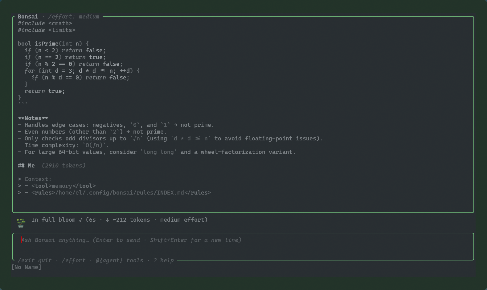
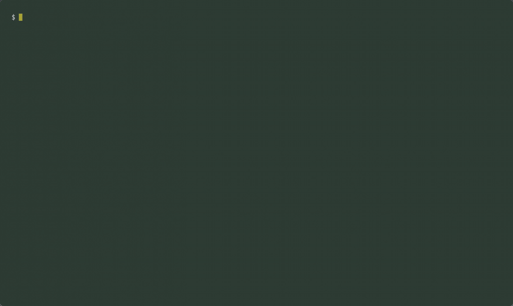
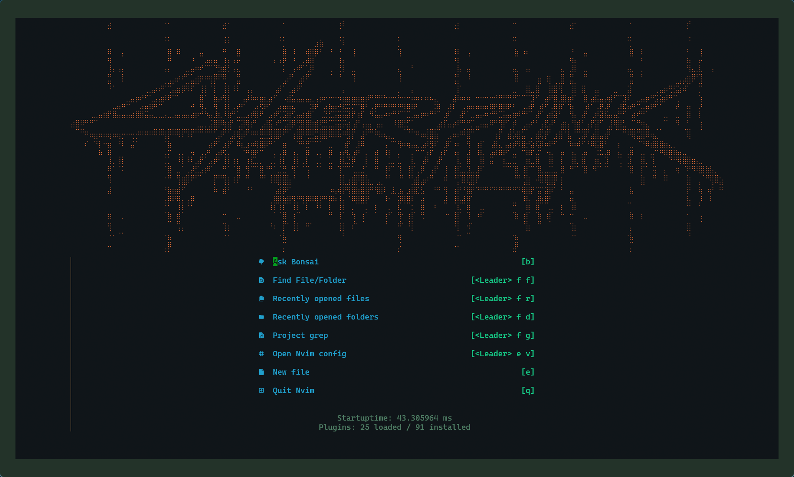
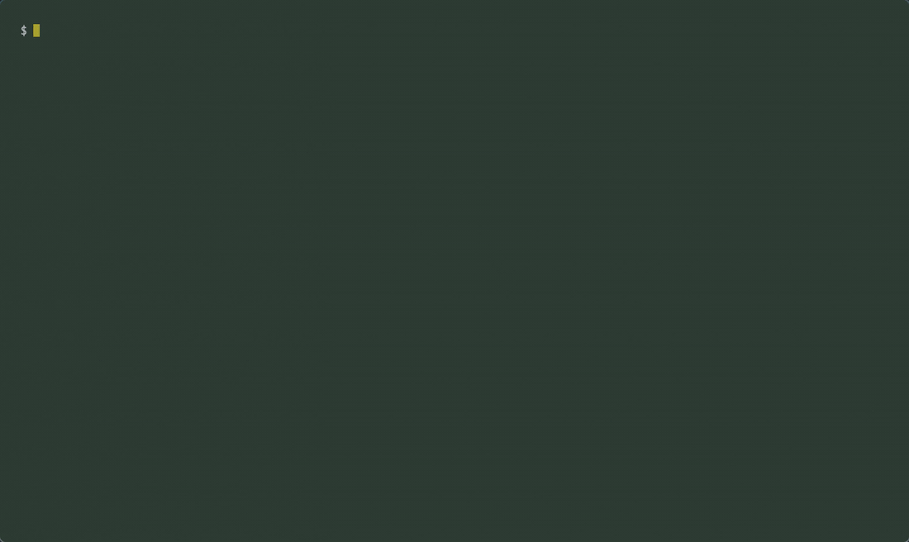

# My Neovim, with Bonsai as a local coding agent

This is the Neovim I use every day on Arch + Hyprland, in kitty with fish. I've shaped it over the year: C++, Java and Python set up the same way, Hello World templates for new files, a live server for web pages, a file tree that opens at the current project, and a terminal panel. The newest part is **agentic coding with Bonsai**: a 27 billion parameter model running on my own GPU, working as a coding agent right in the editor or full screen in the terminal.

Nothing leaves my PC unless I say so. The model runs locally, and every edit, command and website waits for my yes.

**Jump to:** [The Bonsai agent](#the-bonsai-agent) · [The start menu](#the-start-menu) · [C++, Java and Python](#c-java-and-python) · [What else is in here](#what-else-is-in-here) · [What you need](#what-you-need) · [Built with](#built-with)

## The Bonsai agent

Press **Ctrl+A** in normal mode and a panel opens on the right, laid out like Claude Code: the conversation, a status line with an animated pixel art bonsai and a plant word (*Photosynthesizing…*, *Pruning…*, *In full bloom ✓*), and an input box. In the terminal, `bonsai-agent` opens the same thing full screen. It's also in my app menu, and it's the first entry on Neovim's [start menu](#the-start-menu).

<b>/effort: trade speed for context</b>

| Level | Context | Thinks first | Speed on my RTX 3060 (12 GB) |
|---|---|---|---|
| low | 16K | no | ~34 tok/s |
| medium | 32K | no | ~34 tok/s |
| high | 64K | yes | ~34 tok/s |
| max | 180K | yes | ~34 tok/s, or ~14 tok/s if the GPU is full and the cache moves to RAM |

`bonsai-serve` (in my [bonsai](https://github.com/SinaEsmaeili1/bonsai) repo) runs the model on localhost, behind a key that only my own tools have, and it answers browser pages from localhost only. Changing the level reloads it with the new context. Thinking is switched per request.

<b>Sandboxed to the project</b>

- Commands run inside bubblewrap. Only the project folder is writable, the rest of my home folder is hidden, there's no network, and nothing can escalate (no `sudo`).
- The file tools refuse any path outside the project, and symlinks are resolved so they can't sneak out. A call that doesn't name its path is refused too.
- Search, git and diagnostics are held to the project as well: they run only while Neovim's current folder is inside it.
- Opened in `~` or `/`, the tools stay off. The folder is too wide to be a project.

<b>Search without a search API</b>

Bonsai searches through my own [SearXNG](https://github.com/searxng/searxng), running in rootless Podman on this PC only: read only, no capabilities, as an unprivileged user. Pages are read locally with markitdown. Every search and every page waits for my approval.

<b>Markdown driven, not context driven</b>

Context is the expensive part on a consumer GPU, so Bonsai keeps what it learns as short Markdown notes in `~/.config/bonsai/rules`. Only the index is loaded into a chat, and it reads a note when it applies. When I give it a rule, it writes the note itself, and that write waits for my OK too. Old tool output gets trimmed early, and long chats get summarised.

The code is in `lua/bonsai/` (effort, sandbox, notes, search, and the panel in `ui/`) and `lua/config/codecompanion.lua`. Tests: `nvim --headless -c "luafile tests/bonsai/run.lua"`.

## The start menu

Open Neovim without a file and the start menu comes up with one of my ASCII arts on top, picked at random each time: the CYBERPUNK 2077 logo, Mikasa, Chainsaw Man, Gojo, Inosuke, Lucy and three more. It only picks an art that fits the window along with the whole menu, so a small window gets just the menu. The first entry is **Ask Bonsai**: press **b** and the Bonsai panel opens, and if the model isn't running yet, it starts.

The arts are in `lua/dashboard_art.lua`. To add one, I give it a name and paste its lines in as a new entry. Tests: `nvim --headless -c "luafile tests/start_menu/run.lua"`.

## C++, Java and Python

All three work the same way, the way Java did first:

- **A new file starts as Hello World.** `nvim hello.cpp`, `nvim Main.java` or `nvim hello.py` (any name) opens a program that prints `Hello, World!`, and so does a file made in the file tree. New `.html` and `.js` files get theirs too.
- **`<space>r` runs the file** in a terminal below: Python with `python3`, C++ built with clang++ (C++17, warnings on), Java with `java`. Press it again to stop a run.
- **Colors, hints and completion** come from treesitter and a language server for each: clangd, jdtls and pyright.

For web pages, `:live` serves the folder of the current HTML or JS file on localhost:5500, opens it in the browser and reloads it on every save, like VS Code's Live Server. `:live` again stops it.

## What else is in here

- Ctrl+N opens the file tree at the current file's project.
- The start menu also has "Find File/Folder" and "Recently opened folders".
- Ctrl+T opens a terminal panel.

## What you need

- Neovim 0.12, plus kitty for the animated bonsai. Elsewhere, the status line shows just the words.
- For the agent: the [bonsai](https://github.com/SinaEsmaeili1/bonsai) scripts, PrismML's [Ternary Bonsai 2 27B](https://huggingface.co/prism-ml/Ternary-Bonsai-2-27B-gguf) model, bubblewrap, and optionally SearXNG and markitdown for web search. The model isn't in this repo; download the GGUF from Hugging Face.

## Built with

The agent runs on [codecompanion.nvim](https://github.com/olimorris/codecompanion.nvim) by olimorris, and the model is PrismML's Ternary Bonsai. The pixel art bonsai animation is in `assets/bonsai`. I designed the agent and built it with AI assistance.
